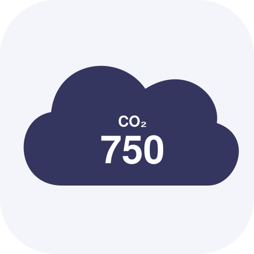

# Qingping Air



A small native macOS menu bar app for **Qingping Air Monitor Lite (CGDN1)**. Reads Bluetooth advertisements directly: no account, Wi-Fi setup, MQTT broker, or Home Assistant.

## Features

- One metric inside a compact, rounded cloud in the menu bar; choose CO₂, PM2.5, PM10, temperature or humidity in settings.
- If any fresh reading enters its configured red zone, the cloud turns red and displays that metric. It returns to your selection when readings recover.
- With multiple alerts, stable priority: CO₂ → PM2.5 → PM10 → temperature → humidity. The panel lists every active alert.
- Closes on outside click, Escape or a second click on the menu bar icon; the panel is positioned below the icon and kept on-screen.
- Click the cloud for all five readings, connection status, device selection and editable thresholds.
- Values older than 60 seconds are unavailable and cannot trigger alerts. Missing values display a dash.
- Remembers your metric, thresholds and sensor locally. Resumes scanning after wake.
- Russian interface. Native SwiftUI/AppKit/CoreBluetooth; no third-party dependencies.

## Build and run

Requires macOS 14+ and Swift 6+ (Xcode or Command Line Tools).

```sh
swift run AirCoreChecks
./scripts/build.sh
ditto -x -k dist/Qingping-Air.zip ~/Applications
open ~/Applications/"Qingping Air.app"
```

Drag the app to Applications if desired. To launch at login, add it under System Settings → General → Login Items. Allow Bluetooth when macOS asks. The build uses an ad-hoc signature, not Developer ID signing or notarization.

Keep the powered monitor nearby. The app listens to Qingping FDCD advertisements, without pairing or writing device settings. If no readings appear, enable BLE Gateway in Mi Home's device settings. Some firmware may only advertise during setup until this is enabled. The app does not configure the monitor. Bluetooth must remain enabled; no readings are collected while the Mac sleeps.

## Red zones

These are **editable application defaults**, not a claim that every firmware or region uses these same colors, and not a medical classification:

| Metric | Red when |
| --- | --- |
| CO₂ | ≥ 2000 ppm |
| PM2.5 | ≥ 75 µg/m³ |
| PM10 | ≥ 150 µg/m³ |
| Temperature | ≤ 16 or ≥ 30 °C |
| Humidity | ≤ 20 or ≥ 70 % |

Thresholds apply immediately and include the boundary. Change them through the gear button. No notification permissions are required. There is no audible alarm or background monitoring while the app is quit.

## Privacy

No internet requests, analytics, account, cloud, or measurement history. Device selection and preferences are stored in local macOS UserDefaults. Device identifiers are not hard-coded. Tests use synthetic identifiers. The icon is an original vector drawing.

## Protocol and alternatives

The decoder reads little-endian TLV fields from FDCD service data: temperature/humidity (`01`), particulate matter (`12`) and CO₂ (`13`). It supports CGDN1 model bytes `0e` and `24`, skips unknown fields and rejects truncated packets. Each metric has its own freshness timestamp.

Protocol references: [WatchFlower CGDN1](https://github.com/emericg/WatchFlower/blob/master/docs/cgdn1-ble-api.md), [Qingping advertisements](https://github.com/emericg/WatchFlower/blob/master/docs/qingping-ble-api.md), [Home Assistant Qingping](https://www.home-assistant.io/integrations/qingping/).

An existing alternative is [Qingping Bar](https://github.com/the-lay/qingping-monitor-macos), with history and device controls via Wi-Fi/MQTT after Bluetooth provisioning. This project is an independent, simpler Bluetooth-only implementation, not a fork.

Independent project; not affiliated with Qingping. MIT licensed.
